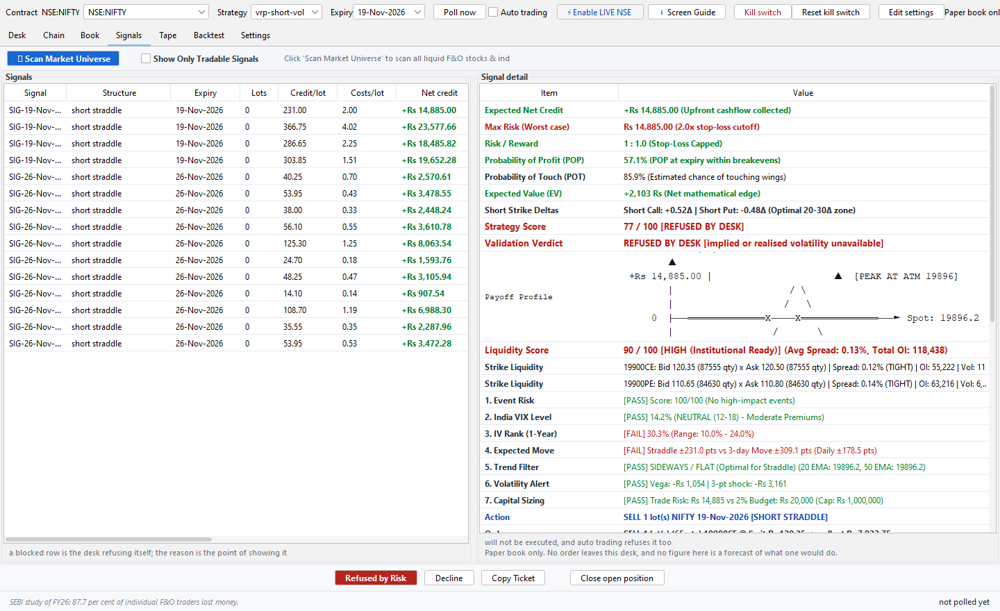
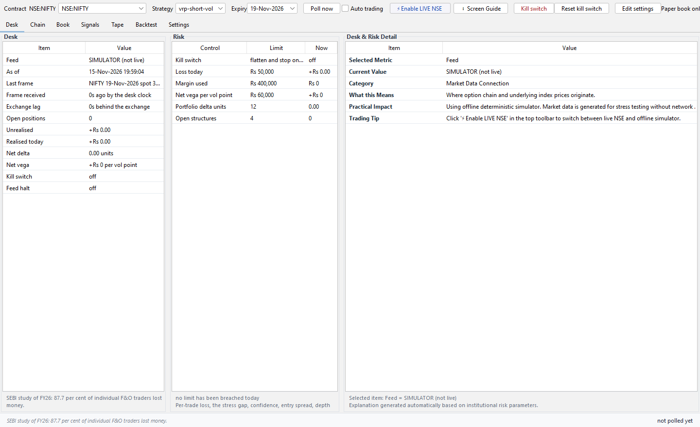
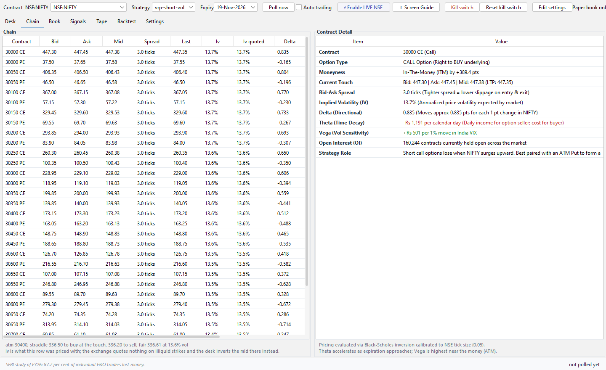
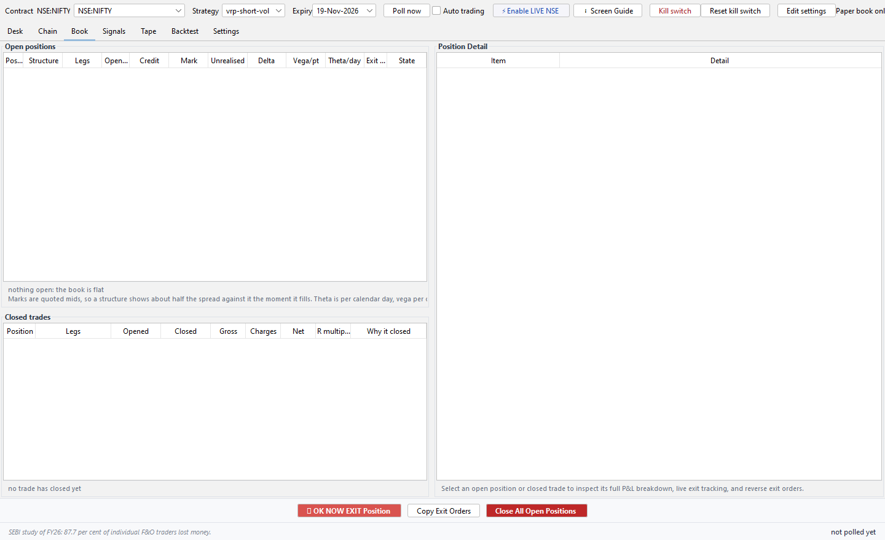

# QuantDesk — NSE/BSE Options Trading Desk

**QuantDesk** is an institutional-grade, quantitative options paper trading desk and volatility screener engineered for Indian equity derivatives (NSE/BSE).

---

## 📸 Screenshots & Desk Interface

### 1. Strategy Screener & Real-Time Risk Analytics
*Scan the entire F&O universe with automated quantitative screening, 8-gate institutional validation, ASCII payoff profiles, probability metrics (POP/POT/EV), and 1-click execution.*



---

### 2. Desk Overview & Greek Exposures
*Real-time dashboard summarizing market regimes, portfolio Greeks (Delta, Gamma, Vega, Theta), margin utilization, and risk status.*



---

### 3. Live Option Chain Matrix & Pricing Analytics
*Streaming NSE option chain with live implied volatilities (IV), Greek distributions, and bid/ask liquidity metrics.*



---

### 4. Paper Book & Live Position Management
*Live position blotter with continuous mark-to-market, automated 50% take-profit / 2.0x stop-loss tracking, dynamic DTE exit alerts, and 1-click `OK NOW EXIT Position` execution.*



---

## ⚡ Key Features

- **Live Market Feed & Historical Replay**:
  - Live option chain connectivity for **NIFTY**, **BANKNIFTY**, **FINNIFTY**, and all liquid NSE F&O equities.
  - Sub-second market data polling with automatic fallback to historical replay tapes and synthetic order books outside market hours.
- **Quantitative Strategy Screener**:
  - Automatically identifies high-probability trading setups across the entire F&O universe:
    - **Iron Condors** (Delta-hedged defined-risk credit spreads)
    - **Covered Calls** (Equity yield enhancement)
    - **Bull Put / Bear Call Spreads** (Directional credit spreads)
    - **Long Straddles / Strangles** (Volatility breakout strategies)
- **Institutional 8-Gate Risk Engine**:
  - Every signal is rigorously validated against strict quantitative gates before entry:
    1. **Event Risk**: Filter out trades near earnings, budgets, RBI MPC meetings.
    2. **India VIX Level**: Ensure market volatility regime favors the chosen strategy.
    3. **IV Rank (1-Year)**: Check implied volatility percentile across historical ranges.
    4. **Expected Move**: Verify option-implied move vs historical straddle pricing.
    5. **Trend Filter**: 20/50 EMA alignment for delta positioning.
    6. **Volatility Shock Alert**: Stress-test against unexpected VIX expansion.
    7. **Bid/Ask Spread & Liquidity**: Reject illiquid strikes with wide slippage.
    8. **Capital Sizing**: Ensure risk is capped within mathematical risk limits.
- **Payoff Analytics & Probability Metrics**:
  - Instant ASCII & graphical payoff curves showing max profit, max risk, and breakeven boundaries.
  - Mathematical risk/reward metrics: Probability of Profit (POP), Probability of Touch (POT), Expected Value (EV), and Short Strike Deltas.
- **Paper Portfolio & Live Order Tracking**:
  - Track active positions in real-time with continuous mark-to-market.
  - Automated exit triggers: Take-profit at 50% credit, stop-loss cutoff at 2.0x credit, and dynamic DTE exit alerts.
  - One-click **"OK NOW EXIT Position"** reversing orders at market mid-prices.
  - Statutory SEBI transaction charges and STT calculations accurately applied.

---

## 🚀 Quick Start / How to Run

### Requirements
- **Java 17 or higher** (OpenJDK 17+, Oracle JDK 17, or Microsoft OpenJDK 17).

### Option 1: Double-Click Launcher (Windows)
Double-click `Run-QuantDesk.bat` in this folder.

### Option 2: Terminal / Command Prompt
```bash
java -jar quantdesk-options.jar
```

---

## 📦 Releases & Standalone Windows Bundle

If you do not have Java installed, you can download the **Self-Contained Windows Executable (`QuantDesk-Windows-x64.zip`)** from our [Releases page](https://github.com/brijesh2020/QuantDesk-App/releases). It bundles its own embedded Java runtime so no installation is required!

---

## ⚖️ Regulatory Notice & Disclaimer

> **Paper Trading & Educational Use Only**:
> No real capital is ever placed at risk through this software. All simulated executions and theoretical fills are strictly for quantitative research, backtesting, and educational purposes.
> 
> *SEBI Study on Individual F&O Traders (FY24): 93% of individual traders in the equity F&O segment incurred net losses.*
